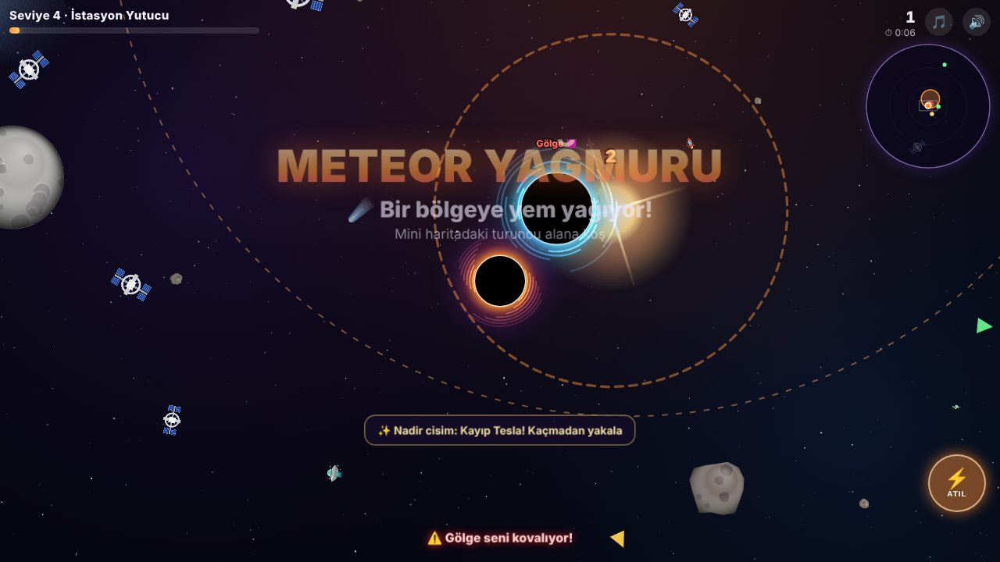
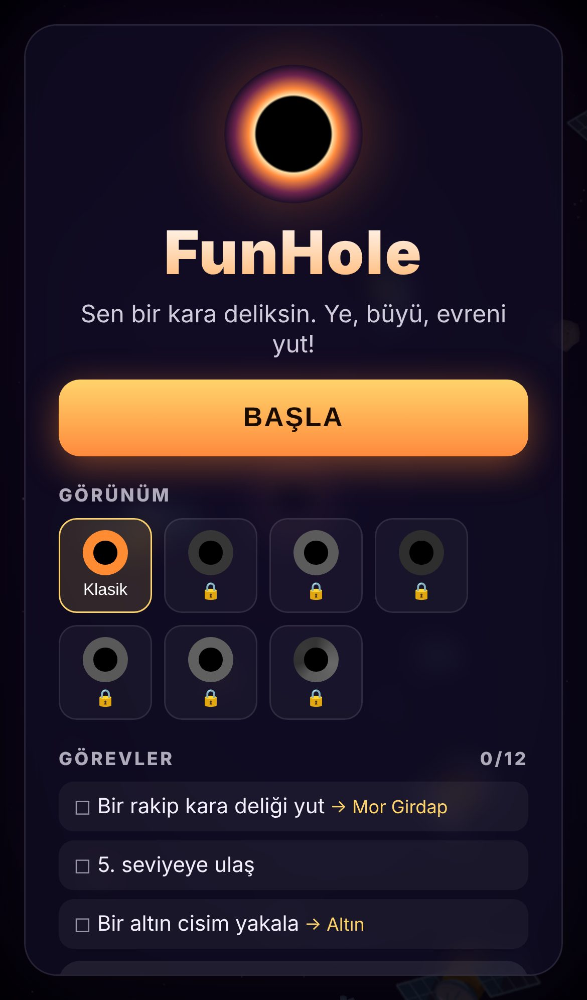
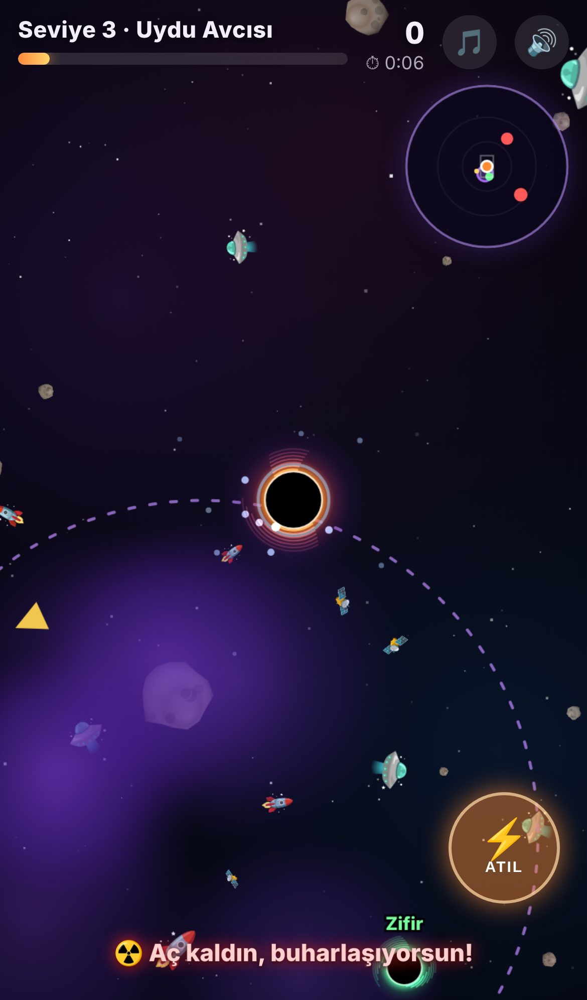
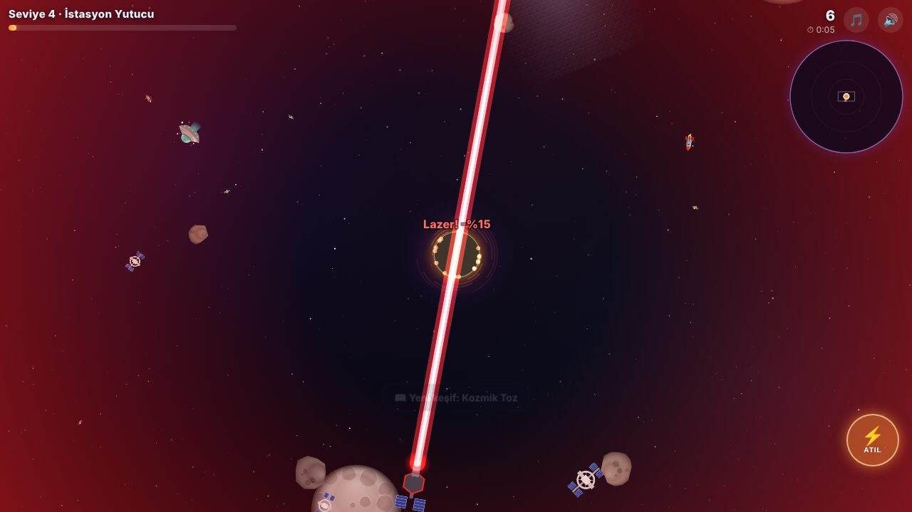

# FunHole 🕳️

Uzayda bir kara deliksin. Senden küçük olan her şeyi yut, büyü, **SIZE UP** al; rakip kara deliklerden kaç, lazerlerden ve süpernovalardan sakın, sonunda galaksileri yutup **evrenin sonu** ol!

Mobilde dokunmatik, masaüstünde fareyle oynanan bir web oyunu. Kurulum gerektirmez: saf HTML + Canvas + JavaScript. Harici kütüphane, görsel ya da ses dosyası yok; her şey kodla çiziliyor ve sesler WebAudio ile üretiliyor.

**Güncel sürüm:** v0.4.0 · [Sürüm notları](CHANGELOG.md)



| Mobil ana menü | Mobilde oyun | Lazer isabeti |
|:-:|:-:|:-:|
|  |  |  |

## Oynamak

- `index.html` dosyasını tarayıcıda aç, ya da bir statik sunucuyla servis et:
  ```bash
  python3 -m http.server 8000
  # http://localhost:8000
  ```
- GitHub Pages ile doğrudan yayınlanabilir: **Settings → Pages → Deploy from a branch → `main` / root**.

## Kontroller

| Platform | Hareket | Atılma |
|----------|---------|--------|
| Masaüstü | Fare imlecine doğru gider (WASD / ok tuşları da çalışır) | Tıkla ya da **Space** |
| Mobil | Ekranın herhangi bir yerine dokunup sürükle (sanal joystick) | **⚡ ATIL** butonu ya da ikinci parmak |

**Atılma** kısa süreli büyük bir hız patlamasıdır; 5 saniyede bir dolar. Rakipten kaçmak, kaçan rakibi ya da altın cismi yakalamak için kullan.

## Nasıl oynanır

- Yarıçapı seninkinin **%90'ından küçük** olan her şeyi yutabilirsin. Senden büyük olanların etrafında **kırmızı kesikli halka** vardır; çarparsan seni iter.
- Yedikçe büyürsün; belli bir boyda **SIZE UP** alırsın, kamera geri çekilir ve artık daha büyük şeyler yiyebilirsin.
- Art arda hızlı yemek **kombo** çarpanı verir.
- **6 saniye** bir şey yemezsen **Hawking ışımasıyla** buharlaşıp küçülmeye başlarsın.
- Bir rakip seni yutarsa oyun biter. Küçülme bir alt sınırda durur, seviyen hiçbir zaman düşmez.

## Seviyeler

| # | İsim | Yiyebileceklerin |
|---|------|------------------|
| 1 | Mikro Kara Delik | Toz, çakıl, vida, kayıp çorap, konserve, eldiven… |
| 2 | Çöp Süpürgesi | Astronotlar, uydular, roket parçaları |
| 3 | Uydu Avcısı | Asteroitler, roketler, UFO'lar |
| 4 | İstasyon Yutucu | Uzay istasyonları, dev lazer uydular |
| 5 | Ay Öğütücü | Kuyruklu yıldızlar, aylar |
| 6 | Gezegen Yiyen | Kayalık gezegenler |
| 7 | Dev Avcısı | Halkalı gaz devleri |
| 8 | Yıldız Yutan | Yıldızlar |
| 9 | Galaksi Canavarı | Kırmızı devler, galaksiler |
| 10 | Evrenin Sonu | Her şey 🌌 (bitirince istersen sonsuz modda devam edersin) |

## Evren ve mini harita

- Evren **dairesel ve sınırlıdır**; kenarı kesikli mor çizgiyle gösterilir. Her SIZE UP'ta evren de seninle birlikte büyür.
- Sağ üstteki **mini harita** evrenin tamamını gösterir:

| İşaret | Anlamı |
|--------|--------|
| Senin renginde nokta + beyaz çerçeve | Sen ve ekranda gördüğün alan |
| 🔴 / 🟢 / ⚪ nokta | Rakip: tehlikeli / yenebilir / denk boyda (büyük rakip = büyük nokta) |
| Turuncu nokta + yanıp sönen halka | Süpernova ve patlama alanı |
| Kırmızı kare | Lazer uydu |
| Altın nokta | Altın (nadir) cisim |
| Turuncu / mor alan, mavi halka | Meteor yağmuru / kara madde bulutu / solucan deliği |

Ekran dışındaki rakipler, süpernovalar, altın cisimler ve olaylar ekran kenarında aynı renkte **oklarla** da gösterilir.

## Rakip kara delikler

Her rakibin bir adı ve kendi renkli diski var: Vakum, Kara Kurt, Obur, Girdap, Hiçlik, Kuyu, Açgözlü, Kaos, Gölge, Zifir.

- **Kim kimi yer:** yarıçapı diğerinin %90'ından küçük olan, büyüğün merkezine girerse yutulur. Bu kural sen, rakipler ve cisimler için aynıdır. Benzer boydakiler birbirini iter.
- **Davranış:** senden büyükse **seni avlar** (gideceğin yeri tahmin eder ama senden biraz yavaştır, bir süre sonra pes eder), senden küçükse **kaçar**, yoksa **yem toplayıp büyür**. Rakipler birbirini de yer.
- Büyük bir rakibin yakınındaysan seni kendine çeker.
- Rakipler evrenin her yerinde yaşar ve sen görmesen de büyür. Sayıları seviyeyle **3'ten 8'e** çıkar.
- 1. seviyedeki rakipler asla senden büyük olamaz; önce rakip yemeyi öğrenirsin.

## Tehlikeler

| Tehlike | Ne yapar | Nasıl başa çıkılır |
|---------|----------|--------------------|
| Lazer uydu (2. seviyeden) | Kırmızı kesikli çizgiyle nişan alır, son anda kilitlenir ve ateş eder; vurursa **%15 küçülürsün** | Çizgiden çekil; büyüyünce yut (bonus puan) |
| Süpernova (3. seviyeden) | Geri sayar, patlama dalgası seni küçültür ve savurur | Halkanın dışına çık ya da patlamadan önce yut |
| Hawking ışıması | 6 saniye yemezsen buharlaşırsın | Durmadan ye |

## Altın cisimler ve uzay olayları

- **Altın cisimler** (Uzay Kedisi, Kayıp Tesla, Voyager Sondası, Lastik Ördek, Uzay Pizzası, Kayıp Uzaylı, Elektro Gitar, Kozmik Kupa): ara sıra belirir, senden kaçar ve 22 saniye sonra kaybolur. Yakalarsan **4 kat kütle** ve **25 kat puan**.
- Olaylar senden uzakta bir bölgede başlar; mini haritaya bakıp oraya gitmen gerekir:
  - ☄️ **Meteor yağmuru:** 28 saniye boyunca o bölgeye yem yağar.
  - 🐌 **Kara madde bulutu:** içinde %60 yavaşlarsın (rakipler de), ama içi yem doludur.
  - 🌀 **Solucan deliği:** içine girersen evrenin uzak bir köşesine ışınlanırsın; çıkışta yem bulursun.

## Görevler, görünümler ve ansiklopedi

- Ana menüde sıradaki 3 görev görünür (toplam **12 görev**). Bazı görevler yeni **kara delik görünümü** açar: Mor Girdap, Altın, Kızıl Lazer, Buz, Zehir, Gökkuşağı.
- **Uzay Ansiklopedisi:** yuttuğun her cisim tipi koleksiyona eklenir (33 kayıt, nadirler dahil). Bulmadıkların gölge olarak görünür.
- İlerleme, en iyi skor ve ayarlar tarayıcıda (`localStorage`) saklanır.

## Ses ve müzik

Arkada WebAudio ile üretilen bir uzay müziği çalar; seviye yükseldikçe temposu ve yoğunluğu artar. 🎵 düğmesiyle müziği, 🔊 ile tüm sesi kapatabilirsin.

## Proje yapısı

| Dosya | İçerik |
|-------|--------|
| `index.html` | Sayfa, HUD ve menüler |
| `style.css` | Arayüz, mini harita ve menü stilleri |
| `js/game.js` | Oyun döngüsü, çizim, yapay zekâ, olaylar, görevler, girdi ve ses |
| `docs/screenshots/` | README ekran görüntüleri |
| `CHANGELOG.md` | Sürüm notları |

### Geliştirme

`index.html?debug` ile açılırsa tarayıcı konsolunda test komutları kullanılabilir:

```js
FunHole.grow(50)            // anında büyü
FunHole.rival(1.5, 0.6)     // oyuncunun 1.5 katı bir rakip, ekranın 0.6'sı uzaklıkta
FunHole.turret(0.5)         // yakında lazer uydu
FunHole.nova()              // süpernova
FunHole.rare()              // altın cisim
FunHole.event('meteor')     // 'meteor' | 'cloud' | 'worm'
FunHole.edge()              // evrenin kenarına ışınlan
FunHole.state               // anlık durum
```
